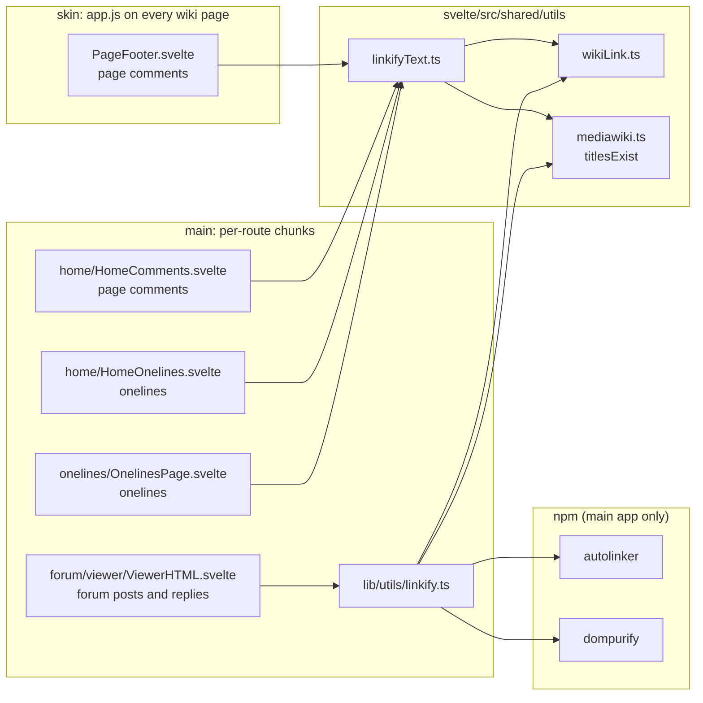

# Frontend

zengine has two Svelte apps:

- **main** (`svelte/`): SvelteKit app for the home page, forum, onelines and tools. Routes are split into chunks, so a library used by one route is downloaded only on that route.
- **skin** (`mwz/skins/ZetaSkin/svelte/`): built into a single `app.js` (IIFE) and `app.css` that every wiki page loads, written with content-hashed names (`app.<hash>.js`) and listed in `dist/assets.php` ([config.md](config.md)). Everything it imports adds to the first page view.

`svelte/src/shared/` holds code used by both; the skin sees it through the symlink `mwz/skins/ZetaSkin/svelte/src/shared`. Code used by only one app belongs in that app's `src/lib/` (`svelte/src/lib/` or `mwz/skins/ZetaSkin/svelte/src/lib/`), so the other app cannot import it by accident and its dependencies do not leak into the other app's checks. The skin's Tailwind build also scans `shared` for class names (`@source`), so main-only components there would add CSS to every wiki page.

`hack/check-shared.mjs` (run by `make checks` with the main Svelte checks) follows `$shared`, `$lib`, relative and CSS `@import` paths from each app and fails when a file in `shared` is used by only one app or by neither. Imports from test files do not count as use. Tests next to a shared file and the CI-written `version.json` are exempt.

## Skin islands

The skin page is rendered by MediaWiki (`templates/skin.mustache`); Svelte components are custom elements (`<c-search>`, `<page-meta>`, `<toc-apex>`, ...) that `app.js` fills in after it loads. Until then each element is empty, so anything that takes space must have that space reserved, or the content below jumps when `app.js` runs (layout shift, CLS).

- Fixed-size islands reserve their box in `svelte/src/assets/islands.css` (e.g. `c-search` min-height, `binder-apex` width on md+).
- Islands whose content the server already knows (the inline table of contents and the disambiguation notice) get server-rendered markup from `includes/StaticMarkup.php` inside the element, wrapped in `.ce-static`. It mirrors the Svelte markup, so it must be updated together with `TocApex`/`TocNode`/`DisambigApex`. Once the element is defined, `:defined > .ce-static` hides it and the Svelte output takes its place in the same frame. It also makes these parts visible without JavaScript.
- When adding or resizing an island, check JS on/off positions at mobile and desktop widths (with ads blocked, this took mobile CLS from 0.29–0.53 to 0 on 2026-10-11).

## MediaWiki markup styles

Styles for markup that MediaWiki core and extensions output (article lists and headings, thumbnails, self links, `mw-collapsible`, the SyntaxHighlight header, the edit form) live in the skin's `svelte/src/assets/mw-*.css`, and template classes in `tpl-*.css`, not in the wiki page `MediaWiki:Common.css`, which is kept empty. Site CSS is a separate render-blocking request (`site.styles`), is not reviewed or versioned with the skin, and its fixed colors do not follow dark mode.

- Classes that wiki templates and modules use go into `tpl-*.css`, one file per template family (`tpl-navbox.css`, `tpl-infobox.css`, `tpl-hanja.css`, ...). Small single-template rules go into `tpl-misc.css` with a comment naming the template. Classes that editors write directly in pages (`version-*`, `count`, `slash`, ...) go into `wiki-classes.css`. This keeps all wiki CSS in one reviewed place instead of spreading it over TemplateStyles pages, and changing it does not re-render every page that uses the template.
- `app.css` imports `tpl-*.css` and `wiki-classes.css` before `mw-*.css`, the order the site CSS used to have against the skin.
- Many templates set colors inline (`style="background:..."`), so infobox and navbox colors stay as they are in dark mode; changing only the box color would mix with the inline colors.
- The `mw-*.css` files are not in a cascade layer, so they win over Tailwind's `@layer base` without `!important`. Keep `!important` only where a rule competes with MediaWiki module styles (`mw-editor.css`).
- Use `light-dark()` or the design tokens for colors, so the rule works in both themes.
- Write plain CSS with `var(--color-*)` tokens rather than `@apply`, so these files do not depend on the Tailwind build. Replace existing `@apply` when a file is edited.
- Write mobile-first: mobile values by default, desktop values under `@media (width >= 48rem)`, which is Tailwind's `md` breakpoint used across the frontend. Do not add other pixel breakpoints.

## Linking user text

User text is turned into HTML with links in two ways, depending on whether the input is plain text or HTML.

| Function | Location | Input | Links | Safety |
| --- | --- | --- | --- | --- |
| `linkifyText` | `svelte/src/shared/utils/linkifyText.ts` | plain text | `http(s)://` URLs, `[[wiki links]]` | escapes the whole text, then inserts only the links it builds; no sanitizer |
| `linkify` | `svelte/src/lib/utils/linkify.ts` | HTML | URLs ([autolinker](https://github.com/gregjacobs/Autolinker.js)), `[[wiki links]]` | sanitizes the result with DOMPurify |

Imports, from the components that render user text down to the libraries:

Forum replies are rendered with `mode="text"` by `ViewerReplies.svelte` through `ViewerHTML.svelte`.

Page comments and onelines are stored as plain text (the API does not escape or sanitize them), so markup such as `<b>` is shown as text.

### linkifyText

- Escapes `& < > " '`, then links tokens. Only `http`/`https` URLs are linked, so `javascript:` and other schemes stay text.
- External links: `class="external" target="_blank" rel="nofollow ugc noopener noreferrer"`. `nofollow ugc` marks them as user-generated, like MediaWiki's `$wgNoFollowLinks`.
- A URL runs until whitespace, `<`, `>`, `"`, `'` or a backtick. It ends at its first unbalanced closing bracket, and trailing `. , ; : ! ?` are dropped: `링크(https://a.com)입니다` links `https://a.com`. Scanning resumes after the trimmed URL, so a following token is still linked. Hangul right after a URL is part of it (`https://a.com/에서`), since URLs such as `https://ko.wikipedia.org/wiki/리눅스` are common.
- Wiki links use the helpers in `svelte/src/shared/utils/wikiLink.ts` (`wikiLinkRegex`, `extractWikiTitles`, `wikiLinkHtml`), shared with `linkify`. Titles are checked in one batch with `titlesExist`, and missing pages get `class="internal new"` and an edit link. Pass all messages of a list in one `linkifyText` call so the check runs once.
- Emails and phone numbers are not linked (MediaWiki links an email only when written as `mailto:`, and a link makes the address easier to harvest).
- Tests: `svelte/src/shared/utils/linkifyText.test.ts` (`pnpm test:unit` in `svelte/`).

### linkify

Used only by the forum, where post bodies are HTML from the editor. autolinker and DOMPurify (about 80 KB minified) are dependencies of the main app only (`svelte/package.json`). The main app sets `ssr = false`, so it imports `dompurify` directly rather than `isomorphic-dompurify`, which adds jsdom for server rendering. The skin's `package.json` does not list them, so nothing in the skin can import them. The skin used them for page comments until v0.9.22, when its `app.js` went from 293 KB to 213 KB (gzip 108 KB to 77 KB).

Forum replies are plain text but still go through `linkify`, because `renderPlainTextWithFences` first turns them into HTML with code blocks.
